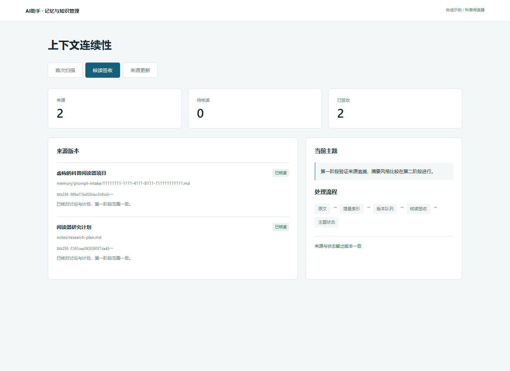

# 个人AI助手记忆与知识管理

一个以文件为事实源的上下文连续性工具：增量导入导出的对话，发现来源变化，按版本记录核读，再恢复主题状态。



## 运行

Python 3.10+，仅使用标准库。

```sh
python demo.py
python -m unittest discover -s tests -v
python -m http.server 8000 --directory docs
```

打开 http://localhost:8000 或直接打开 `docs/index.html`。演示会在`runtime/`创建虚构工作区，运行首次扫描、人工核读示例、资料更新及旧签收拒绝。真实笔记、账号配置和历史对话均不在仓库内。

## 工作机制

1. `prompt_intake.py`逐行增量读取显式指定的JSONL导出目录；内容散列、文件偏移和SQLite索引支持重复导入与追加。
2. `continuity.py scan`对比来源版本与核读账本，生成待核读队列；发现与理解分别记录。
3. 维护者阅读来源、更新主题状态，提交包含实际版本SHA和输出文件的核读计划。
4. `continuity.py seal`校验版本与输出路径，签收已读版本；来源更新后重新进入队列。
5. `knowledge_gate.py`检查受控标签、Markdown本地链接和知识图谱引用。

```sh
python tools/prompt_intake.py --roots examples/sessions --output runtime/memory/prompt-intake
python tools/continuity.py scan --root runtime --brief
python tools/knowledge_gate.py runtime
```

## 设计与AI辅助开发

作者围绕长期AI协作中的上下文丢失、信息过期与来源混用提出需求，设计记忆分层、主题恢复、版本核读及验收规则；借助AI完成Python实现、数据结构、校验与迭代。公开版从实际使用的机制抽取通用代码，演示材料重新编写为虚构内容。

## 文件分层

`notes/`是原文层；`memory/prompt-intake/`是派生消息索引；`memory/continuity/`维护版本队列与核读记录；`state/`保存可恢复主题状态；`memory/classification/`维护标签；可选的`knowledge-graph.json`连接实体与来源。

## 适用边界

这是文件式协作基础设施，不包含向量数据库、聊天模型调用或自动事实理解。导入器仅处理README所列JSONL结构，并不连接聊天账号。自动提示与常见凭据格式过滤用于减少误收；接入自己的材料时仍需检查原文及输出。

详见[架构与数据流](ARCHITECTURE.md)。公开演示由真实Python运行结果生成；GitHub Pages选择GitHub Actions后可运行Demo工作流。
